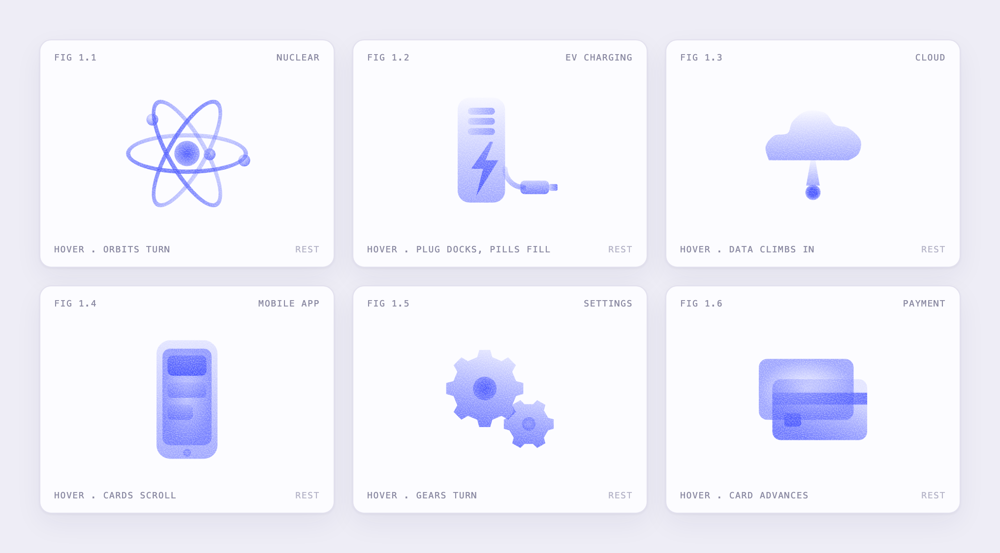
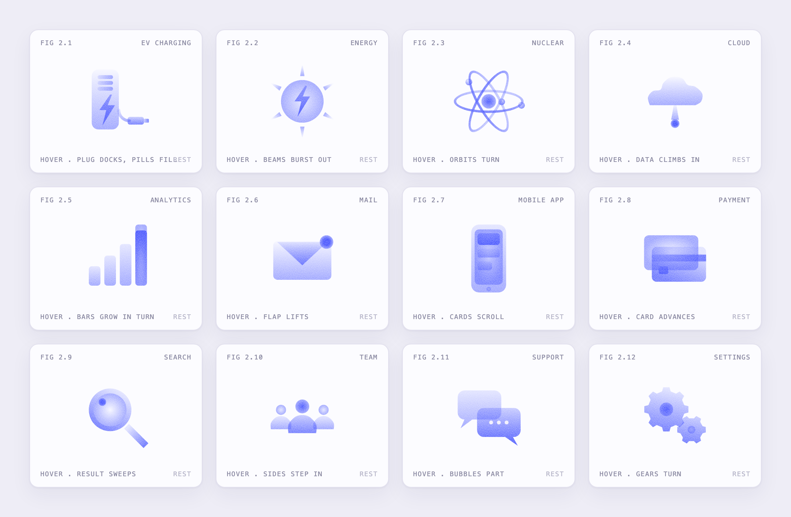
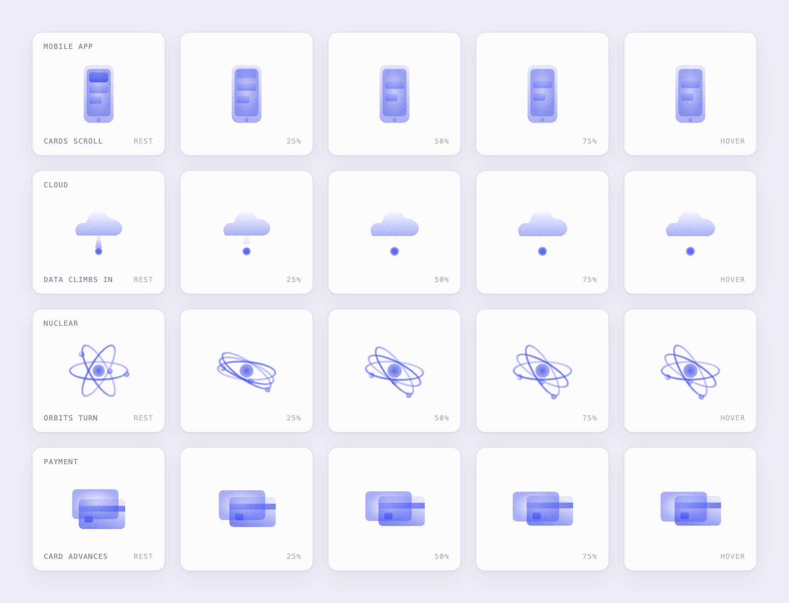
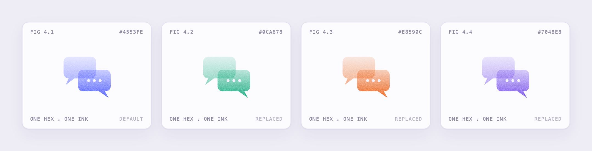
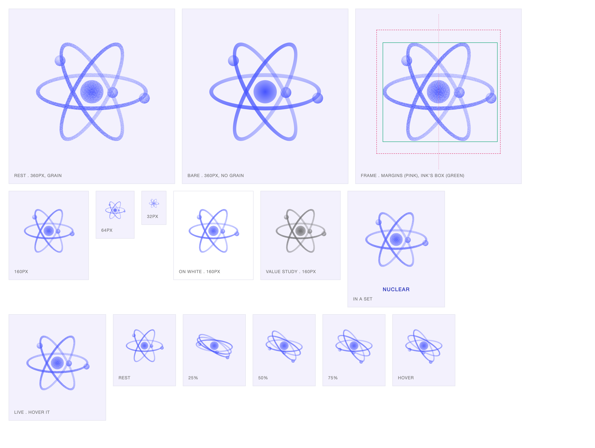

# Lumen

**A Claude Code skill that draws luminous, geometric illustrations as SVG: one ink, gradients that dissolve into the paper, fine grain, and a gesture on hover.**



You describe an illustration ("a charging station", "something for energy", a list of twelve web-design subjects) and Lumen draws it in one consistent style, checks it, and hands you an SVG you can drop in a page. It can also redraw an icon you already have in the same style.

- **One ink on pale paper.** Every shape is a gradient from the ink to almost nothing, then grained. No flat fills, and by default no lines.
- **One SVG.** 200 × 200, transparent, a few KB. The recolour is one hex.
- **Answers the hover.** On hover (or keyboard focus on the card that holds it) a piece does the verb of its idea (the plug docks, the cards scroll, the orbits turn) and comes back. Plain CSS, no script, still for people who ask for reduced motion.
- **Two skills.** `/lumen-create <idea>` and `/lumen-adopt <file>`.

## The twelve classic web-design subjects

A test batch drawn by the skill (EV charging, energy, nuclear, then cloud, analytics, mail, mobile app, payment, search, team, support, settings). Sources and SVGs are in [`gallery/web-design`](gallery/web-design).



## What a piece looks like

A piece is a small file written against a fixed kit. It names a level of ink and calls a shape; it never writes a colour, a gradient, a filter or a line of CSS, so every piece of a set comes out alike.

```js
lumen({
  name: "mail",
  means: "An envelope with a notification badge at its corner. On hover the flap lifts away and the badge swells.",
  draw(L) {
    const { rect, poly, disc, fade, glow, move } = L;
    rect(40, 64, 120, 80, fade("air", "mid", 90), 9);                          // the body, light above, deeper below
    const flap = poly([[48, 66], [152, 66], [100, 114]], fade("mist", "deep", 90));
    const badge = disc(150, 66, 14, glow("core", "core", "mid"));             // the one dense point: the core
    move(flap, "drift", { dy: -10, fade: 0.35 });                              // the hover: the flap lifts
    move(badge, "swell", { to: 1.25 });
  },
});
```

The six levels are `core · deep · mid · soft · mist · air`. A piece has one core, the place the eye starts, and everything else dissolves away from it.

## The hover

A piece has two designed poses, rest and hover, and the CSS moves between them with a transition, so it can be interrupted at any moment and comes back from where it is. Three moves cover it: **drift** (goes out), **swell** (grows), **spin** (turns), each with an optional `fade`, a duration and a stagger.



- The trigger is the SVG itself, or any ancestor with the class `lm-host` (hover and keyboard focus). A box that never moves, so a part sliding from under the pointer cannot make the hover flicker.
- The rest pose is the still piece: it is what an ``, a slide, a thumbnail or a reduced-motion visitor sees.
- To answer the hover the SVG must be **inline** in the page. A browser does not deliver hover to an ``.

```html
<a class="lm-host" href="/security">
  <!-- paste the markup of the .svg here -->
  <span>Security</span>
</a>
```

## One ink, one hex

A piece contains a single colour, repeated across its gradients. Replace it in the file, or set `palette.ink` in the style and regenerate the whole set.



Today the ink is fixed in the file: a page cannot recolour it with CSS (no `currentColor`, no variable). That would be a small change in the kit, and it would work for inline SVGs only.

## Taste is a setting, not a law

The skill separates the **engine** (`kit.mjs`: it draws, measures and writes the CSS) from your **taste** (`style.mjs`, one file that is yours). Three sections, from the firmest to the loosest:

| | What it is | Examples |
| --- | --- | --- |
| **Identity** | what makes a piece Lumen | the palette, the six opacity levels, the grain |
| **Taste** | what you like today, and can flip | `lines.allowed` (off), `lines.arrows` (off), `motion.loops` (off), line weight and opacity, durations |
| **Limits** | rules of thumb for legibility at 64px | number of shapes, size of the masses, how far a part may drift, how long a gesture lasts |

```js
// style.mjs
lines:  { allowed: true, arrows: false, weight: 1, opacity: 0.8 },  // lines are back, without arrows
motion: { hover: true, loops: true },                                // hover, and loops allowed
```

Try a taste for one run without editing the file: `LUMEN_STYLE=my-style.json node skills/lumen-create/look.mjs piece.js`.

This split exists because taste changes. In the first week of this project the lines went from "too strong" to "no arrows" to "no lines at all", and the hover from "also loops" to "mostly hover". Each change should be one line in a settings file, not a rewrite of the engine and of every piece. The skill's instructions say so explicitly: a stated preference is a setting, and "this looks odd" is a diagnosis to make, not an order to delete.

### Errors and warnings

The validator stops a piece only for what would break it, and notes the rest.

- **Error:** the piece cannot be drawn, would break the file or leaves the style's identity. A script or markup in the SVG, a colour outside the palette, a drawing **cut** by the frame, an unsafe filename, CSS written by hand.
- **Warning:** a rule of thumb with its limit in `style.mjs`. Too many shapes, masses too small or too big, a paint that reads flat, a gesture that drags, a drawing near the edge. The piece is still handed over. `--strict` turns warnings into errors.

## The check

`look.mjs` is the part that keeps the skill honest. It draws the piece, validates it, **measures the ink on real screenshots** (is it cut by the frame, how much of it is in a fade, is there a core, does the grain show, is it all palette, how much moves on hover) and writes one sheet to look at: with and without grain, the frame, at 160, 64 and 32px, on white, as a value study in grey, and five frames of the hover.



## Use it

**Requirements:** Node 18.3 or later, and a Chrome, Chromium, Edge or Brave on the machine (the check drives it headless; `LUMEN_CHROME` points at a specific one). Nothing else to install. Tested on macOS with Node 20.

```bash
git clone https://github.com/MaximeLamanda/lumen-skill.git
cd lumen-skill
ln -s "$PWD/skills/lumen-create" ~/.claude/skills/lumen-create
ln -s "$PWD/skills/lumen-adopt"  ~/.claude/skills/lumen-adopt
```

Then, in Claude Code:

```
/lumen-create a charging station for electric cars
/lumen-create six illustrations: security, cloud, analytics, mail, payment, search
/lumen-adopt icons/rocket.svg
```

You can also run the tools yourself, from a working folder:

```bash
node skills/lumen-create/look.mjs gallery/web-design/nuclear.js     # validate, measure, write the sheet
node skills/lumen-create/sheet.mjs gallery/web-design/*.svg         # a set, with live hover in the .html
node skills/lumen-create/strip.mjs gallery/web-design/*.js          # rest to hover, one row per piece
node skills/lumen-create/tests/run.mjs                              # 37 cases
node tools/readme-images.mjs                                        # rebuild the pictures above
```

### What is in the repo

| | |
| --- | --- |
| `skills/lumen-create` | the skill: `SKILL.md`, the rules, the kit, `style.mjs`, the validator, the check, the examples, the tests |
| `skills/lumen-adopt` | redraws an SVG or a picture you bring, keeping its parts and proportions and none of its colours |
| `gallery/web-design` | the 12 subjects above: source, animated SVG, rest-only SVG |
| `gallery/studies` | seven earlier studies (performance, flow, value, depth, deploy, matrix, security) |
| `docs`, `tools` | the pictures of this README and the script that makes them |

## Does it work?

Two kinds of evidence, and where they stop.

- **A test suite (37 cases)** pins down what is an error, what is only a warning, and what each setting does: lines and loops off by default and refused with the way to turn them on, seeded randomness, limits that move with `style.mjs`.
- **A real batch.** The twelve subjects above were drawn from a one-line brief each. Result: no validator error on any first draft, and **four pieces still needed revising once I looked at them**. A cloud with three dots under it read as rain; a bar chart with a floating marker read as an "i"; the EV-charging hover barely moved (12% of the ink, and it had passed the check). The validator and the measures cannot see a misreading; only eyes can. That is the next thing the skill should ask for explicitly.

**Known limits**

- Hover is verified with a real pointer on the first set and on frozen frames of the gesture on the batch; keyboard focus is written but not tried.
- No hover on touch screens: they show the rest pose.
- No video, GIF or Lottie export. The format is the animated SVG; `strip.mjs` gives a picture of the gesture.
- The batch was drawn by the same agent that wrote the skill, so it is not an independent test.
- Organic shapes (a hand, a head) are out of reach of the primitives; there is no free `path()` yet.

## Credits and licence

The look takes its cue from a family of gradient, grained, single-ink geometric icon sets. Built with [Claude Code](https://claude.com/claude-code).

[MIT](LICENSE) © 2026 Maxime Lamanda. A third-party licence notice is in [NOTICE.md](NOTICE.md).

---

## En bref (français)

**Lumen** est un skill pour Claude Code qui dessine des illustrations SVG dans un style précis : une seule encre bleue sur papier lavande, des dégradés qui se fondent dans le papier, un grain fin, pas de trait par défaut. Chaque pièce peut répondre au survol avec le verbe de son idée (la prise se branche, les cartes défilent, les orbites tournent), en CSS pur, sans script.

- `/lumen-create <idée>` dessine, vérifie (validateur + mesures sur captures réelles) et livre un SVG ; `/lumen-adopt <fichier>` redessine un icône existant dans ce style.
- Le moteur (`kit.mjs`) est séparé de ton goût (`style.mjs`) : traits, flèches, boucles et limites sont des **réglages**, pas des interdits. Le validateur distingue erreurs et avertissements.
- Une pièce n'a qu'**une couleur** (un hex à remplacer). Pour qu'elle réponde au survol, le SVG doit être **inline** dans la page.
- Testé sur un lot de 12 sujets classiques de web design : aucune erreur du validateur, mais 4 pièces ont dû être corrigées à l'œil, parce que les mesures ne voient pas une mauvaise lecture.
